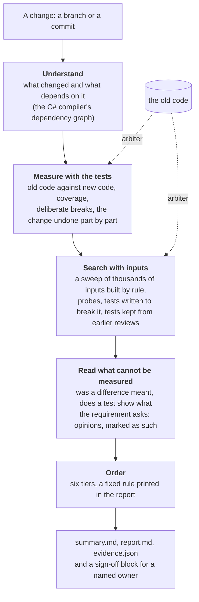

# AYA

**Know where to look, and what to trust, in a code change written by an AI.**

Built for the Tieto challenge at Junction 2026: *how can AI review code made by AI so that humans can trust it?*

`aya review` takes a change (a branch or a commit of a C# repository) and orders everything it touches by how much
it deserves a person's attention before approval, with a measurement behind every place in the list. It never
approves and it never says something can be skipped: the last tier of the list means *no signal was found*, not
*this is safe*. A named person decides how far down to read, and signs.

- [How it works](#how-it-works)
- [Quick start](#quick-start)
- [Reading the output](#reading-the-output)
- [Results on the challenge branches](#results-on-the-challenge-branches)
- [Limits](#limits) · [What comes next](#what-comes-next)

## How it works

A second model that reads a change and gives a verdict asks to be believed. AYA does not ask that. It runs the
code before and after the change, and lets the old code decide.



Five principles hold it together:

1. **The old code is the arbiter.** Every check runs on the code before the change and on the code after it. A
   test that fails on the new code counts only if it passes on the old.
2. **Measured first, without a model.** Tests on both versions, coverage of the changed lines, each changed line
   broken on purpose, the change undone one part at a time, and a sweep of inputs built by rule.
3. **What a model writes is run, not believed.** Models write probes and tests, one session per unit, each knowing
   only its own unit. AYA builds and runs every file. A test that showed a regression is kept and run again on
   every later review of the branch.
4. **What a model believes is shown as a belief.** A judge says whether a difference was meant and reads the
   requirement against the tests. The words it quotes must be in the requirement, and a test it names must be one
   that fails on the old code. A reading can move an item up the list, never down.
5. **A model may lower trust on its opinion, and raise it only through something that was measured.**

### How risk is shown

Not as one number. Four things are known with very different certainty, so they are shown apart:

| | The question | Where it comes from |
|---|---|---|
| Likelihood | Is it easy for this to be wrong? | Modified or new code; old code against new code on the same inputs; tests written to break it |
| Impact | How much breaks if it is wrong? | What depends on it (compiler); how many tests fail when it is broken on purpose |
| Detection | Would anything notice? | Which changed lines ran; deliberate breaks that no test caught; parts of the change no test needs |
| Sight | What can the analysis not see? | Deleted code, generated code, conditional compilation |

### The stages

Only the first row runs by default. The others are switched on one by one.

| Option | What it measures | Uses a model |
|---|---|---|
| *(always)* | Classifies every changed file. Builds the dependency graph. Runs the tests on the old and the new code and compares them one by one. Runs the tests that came with the change against the old code: a test that passes without the change shows nothing about it. | no |
| `--mutate` | Alters each changed line in turn and records whether a test fails. Then undoes the change one part at a time: a part that can be put back with every test passing is needed by no test. | no |
| `--sweep` | Runs inputs nobody chose through the old and the new code (see below). | only for the harness |
| `--compare` | A probe records what a modified unit does on a set of inputs; it runs twice on the old code, to discard what is unstable, and once on the new. | writes the probe |
| `--attack` | Tests written to break each changed unit. One that fails on the new code is run on the old, which decides. Tests that showed a regression in an earlier review are run again. | writes the tests |
| `--write-tests` | Tests for lines that never run and breaks nobody notices; accepted only if they compile, pass and are measured to reach their target. | writes the tests |
| `--exhaustive` | Probes older code that depends on the change and that no test executes. | writes the probes |
| `--judge` | For each difference the change's own text does not explain: was it meant, not meant, or an artefact of the build? With `--req-file`: which things the requirement asks for does a test show? | gives an opinion |

### The input layer

Between the tests and the sweep sits a layer that decides which inputs exist. No model chooses or writes an input.

- **Where inputs come from.** The sources the existing tests hold, as they were before the change. The sources of
  analyzer tests with their expectation marks removed: the inputs with defects in them. And the sources of the
  tests that came with the change, which run on the new code alone.
- **How they are altered.** First with what the change itself writes out: an attribute it emits, put on every
  type; a symbol it tests in an `#if`, defined. Then by a family of 34 alterations built from a few schemes over
  C# syntax: take one thing out (an attribute, a modifier, a member, a base type), swap a thing for another of its
  kind (class, struct, record; accessibility; property or field), alter a literal, move a type to a referenced
  library or nest it, wrap a member's type. The budget is shared evenly among them.
- **What is observed.** The diagnostics, the generated code, whether the tool under test crashes, whether what it
  generates compiles, and what the user's own types look like afterwards.

A difference made only of lines the change itself adds or removes is labelled as *the change showing through*,
without a model, and goes after the differences nothing explains.

This version of the layer knows one kind of input: C# source held in the string literals of tests, which is what a
source generator or an analyzer is tested with.

## Quick start

### Requirements

- git, and the [.NET 8 SDK](https://dotnet.microsoft.com/download). The challenge repository also needs the
  .NET 9 SDK: its source generator is built against a newer compiler than the SDK it pins. AYA detects this and
  builds old and new code with the same, newer one (`--sdk auto`, the default).
- Only for the stages that use a model: the Antigravity command line (`agy`), signed in, which gives access to
  Gemini; or the `claude` command line with `--writer claude`. Without either, the first three rows of the table
  above still run in full.
- Developed and run on Windows 11. Nothing in it is Windows-only by design, and it has not been run elsewhere.

### Build

```bash
git clone https://github.com/Jjumper007/ValenTech-Junction.git
cd ValenTech-Junction
dotnet build src/Aya/Aya.csproj
dotnet test tests/Aya.Tests/Aya.Tests.csproj      # AYA's own tests
```

### Review a change without any model

Under ten minutes on the challenge repository. About 1,250 tests run on both versions, and twenty deliberate
breaks and eight undone parts are tried.

```bash
dotnet src/Aya/bin/Debug/net8.0/aya.dll review \
    --repo https://github.com/te-industry-tech-office/junction26-messagepack-csharp \
    --head ju26-issue-2283 \
    --mutate
```

`--repo` is a URL, cloned under `~/.aya/repos`, or a local clone. `--head` is the branch, tag or commit with the
change. `--base` defaults to its merge base with the default branch.

### The full review

Fourteen to twenty-five minutes per branch, most of it building and running the target's tests.

```bash
dotnet src/Aya/bin/Debug/net8.0/aya.dll review \
    --repo https://github.com/te-industry-tech-office/junction26-messagepack-csharp \
    --head ju26-issue-2283 \
    --req "MessagePack-CSharp#2283" --req-file results/requirements/2283.md \
    --mutate --compare --sweep --max-inputs 3000 --write-tests --attack --exhaustive --judge
```

`--req-file` is the text of the requirement, supplied by whoever reviews. AYA does not fetch it.

### Arbitrate tests someone else wrote

A reviewer, human or model, who believes they found a defect can hand the test to the arbiter. Tests go in a
folder as `A1.cs`, `A2.cs`…, each with one class named `AyaA1Attack`, `AyaA2Attack`…

```bash
dotnet src/Aya/bin/Debug/net8.0/aya.dll review --repo <repo> --head <ref> --attack-from <folder>
```

### Options

| Option | Default | |
|---|---|---|
| `--out <dir>` | `aya-out/<head>` | Where the reports go |
| `--sdk auto\|repo\|latest` | `auto` | Which .NET SDK builds the target. Old and new are always built with the same one |
| `--skip-tests` | off | Graph and change map only |
| `--max-mutants <n>` | 20 | Deliberate breaks to try |
| `--max-reverts <n>` | 8 | Parts of the change to undo |
| `--max-inputs <n>` | 240 | Inputs of the sweep |
| `--max-probes <n>` | 4 | Units to compare with a probe |
| `--max-tests <n>` | 4 | Tests to ask for |
| `--max-attacks <n>` | all | Units to attack |
| `--max-sessions <n>` | 10 | Session budget of `--exhaustive` |
| `--writer gemini\|claude` | `gemini` | `gemini-4-hydrogen-medium` through `agy`, or `claude-opus-5-5` through `claude` |
| `--writer-model <id>` | | Another model of the same provider |

`aya --help` prints all of them. Working copies and clones live under `~/.aya` (override with `AYA_HOME`; give each
parallel review its own). Exit code: 0 no failing evidence, 1 failing evidence, 2 usage or environment error.

## Reading the output

| File | What it is |
|---|---|
| `summary.md` | One screen to read before approving: what to look at, in order, why, and what to check there |
| `report.md` | The whole ordered list, every measurement, what was not checked, what AYA refused to decide, and a sign-off block |
| `evidence.json` | Every number the report quotes. The report names this file by its sha256 |
| `graph.json` | The dependency graph, with the changed units marked |
| `pipeline.log` | What was done, step by step, with timings |
| `attacks/`, `probes/`, `proposed-tests/` | The code models wrote, as it was built and run |

The order is a fixed rule, printed in every report so the owner can disagree with it:

1. **A check that passed on the old code fails on the new.** An existing test, an input of the sweep, or a test
   written to break it and arbitrated by the old code.
2. **Changes a result that existed before.** First what nothing explains, or a model reads as not meant.
3. **Existing code others depend on, where a mistake would go unnoticed.**
4. **Could not be measured.** Including what the requirement asks for and no test shows.
5. **A mistake here would go unnoticed** (new code, or code nothing depends on).
6. **No signal found.** Not the same as correct.

## Results on the challenge branches

Four agent-written changes to `te-industry-tech-office/junction26-messagepack-csharp`. All four pass every test
that existed before them. The reports AYA wrote are in [`results/`](results/), one folder per branch.

| Branch | Time | Sweep | What AYA puts first |
|---|---|---|---|
| `ju26-issue-2297`<br/>generated code excluded from coverage, 237 files | 16 min | 2,995 inputs; 3 that worked no longer do; 1,811 of 1,860 differences are the change showing through | User code that already has the attribute stops compiling (`CS0579`): the sweep, two attack tests and eight kept ones |
| `ju26-issue-2283`<br/>crash on types of a referenced assembly, 4 files | 19 min | 2,542 inputs, none differs | Errors about defective types of a referenced project are no longer reported (a kept test). The new filter is needed by one test, which came with the change |
| `ju26-issue-2234`<br/>analyzer fix, 4 files | 14 min | 2,542 inputs; 49 differ, all only once altered | A lost diagnostic (an attack test and three kept ones). Generated code that no longer compiles for a type with a repeated key |
| `ju26-issue-2129`<br/>new feature, 28 files | 25 min | 2,542 inputs, none differs; they run 58 of 276 changed lines | No regression found. The list of supported diagnostics grows, read as the new feature; an equality method that 57 members depend on was modified where a mistake would go unnoticed. None of the five things the requirement asks for is shown by a test that fails without the change. 65 lines never run, 19 breaks go unnoticed, and three sets of tests about the new feature fail with no old code to judge them |

**Against a review by reading and running.** Four independent reviewers, who did not see AYA's output, read each
issue and change and ran their own tests. They reported 29 findings. AYA puts 11 in front of the owner as
something measured, 2 as a model's opinion, 4 as a signal pointing at the place, and does not show 12. The
reviewers found more. Their own tests were then handed to AYA's arbiter:

| 51 reviewer tests | |
|---|---|
| 16 | fail on the new code and pass on the old: the change caused it. Kept, and run on every later review |
| 8 | fail on both: true of the code, not caused by the change |
| 23 | fail on the new code with no old code to arbitrate: defects of a new feature |
| 4 | pass on both, as written |

Finding by finding, with what AYA shows, by which check, and whether that check existed before the reviews were
read: [`results/contrast.md`](results/contrast.md).

**What repeats and what does not.** Tests, coverage, deliberate breaks, undone parts and the sweep came out the
same in every pass. The attack tests differed from one pass to the next, and a judge read the same requirement as
contradicted in one pass and as fully shown in the next. That is why demonstrated tests are kept, and why a
reading is never shown as more than a reading.

## Repository layout

```
src/Aya/            the tool (C#, .NET 8, Roslyn)
  Review.cs           the pipeline, start to finish
  Diff.cs  CodeGraph.cs            reading the change; the dependency graph
  TestRunner.cs  Mutation.cs       tests and coverage; deliberate breaks; undoing the change part by part
  Sweep.cs                         the input layer and the sweep
  Compare.cs                       probes; old against new; what the change's own text explains
  Attack.cs  TestWriter.cs         tests to break, tests for gaps, tests kept between reviews
  Judge.cs                         the judge and the reading of the requirement
  ModelSession.cs                  model sessions in parallel, one per unit, with no access to files
  Attention.cs  Evidence.cs  Report.cs   the ordering rule, the evidence, the reports
tests/Aya.Tests/    AYA's own tests: one for every way it was found to say more than it had measured
results/            what AYA wrote on the four challenge branches, and the contrast with an independent review
```

## Limits

- It measures what code does, not what it should do. Whether a change fulfils its requirement is never measured;
  with `--req-file` a model gives a reading, shown as an opinion.
- The sweep reaches only what the existing tests hold inputs for. Its alterations were chosen after an
  independent review had been read, to find what that review found. Nothing here shows that it finds defects
  nobody has seen.
- For code that is entirely new the old version cannot arbitrate. A failing test about a new feature is reported
  as an open question for a person, never as a regression.
- A line that ran under a passing test is not proven correct. An accepted test is not proven worth keeping.
- Deleted code is listed as not analysed. Calls made through reflection or generated code are not edges of the
  graph.
- It reviews C#. The input layer of the sweep knows one kind of input, C# source.
- It never approves. Every report ends with a sign-off block for a named owner.

## What comes next

- Run the sweep on changes nobody has reviewed: past fixes in the target's 3,300 commits, each against its
  parent, counting on how many the sweep shows the difference the fix made.
- Apply two alterations at once. The lost diagnostics of `ju26-issue-2283` appear only when a type is both in a
  referenced library and defective.
- Record the effect of generated code, not only its text, so that "under this configuration the change does
  nothing" is measured and not left to a reading.
- Builders of inputs for code that takes values instead of source: boundary and random values with the old code
  as the oracle.
- A fixed harness per kind of code, to take the last model out of the sweep.
